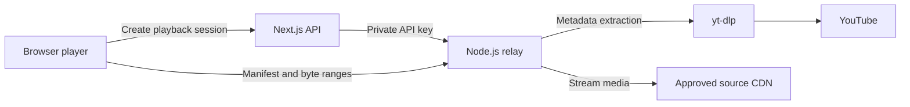

<div align="center">

# YouTube Relay Player

**Your screen. Your player. Your relay.**

A self-hosted Next.js video player backed by a lightweight Node.js DASH relay.

[](https://github.com/Tofaal9152/youtube-relay-player/actions/workflows/ci.yml)
[](LICENSE)
[](https://nodejs.org/)

[Quick start](#quick-start) · [How it works](#how-it-works) · [Self-hosting](docs/self-hosting.md) · [Contributing](CONTRIBUTING.md)

</div>

Paste a public YouTube link, choose a quality and watch in a clean player. Original media URLs stay on your relay; the browser receives temporary relay URLs. Video is streamed on demand without saving full video files to disk.

**This is an experimental relay, not a managed video hosting service.** YouTube can challenge datacenter IPs or invalidate cookies. The included public DASH test clip lets you check the player and relay independently of YouTube. Relay URLs remain visible in browser tools; this does not provide DRM or prevent downloads.

## Features

- Responsive dark interface with a purple theme.
- `next-video/player` with the Sutro theme: seeking, volume, speed and fullscreen controls; picture-in-picture where supported.
- Adaptive DASH playback and manual quality selection up to 1080p when compatible tracks are available.
- Separate H.264 video and AAC audio, using the source's existing encoded qualities.
- Temporary playback sessions, connection status and outgoing-byte counters.
- Byte-range streaming for seeking, with no server-side transcoding or permanent video storage.
- A public DASH sample for testing without a YouTube account or extractor.
- Server-only relay credentials, source-host validation, origin checks and basic session-creation rate limiting.

## Quick start

Requirements: **Node.js 22+**, npm and, for YouTube extraction, **Python 3.10+** and a current `yt-dlp` executable.

```sh
git clone https://github.com/Tofaal9152/youtube-relay-player.git
cd youtube-relay-player
npm ci
npm run setup
```

The setup command creates `.env.local` and `backend/.env` with the same random relay key and owner-only permissions. It refuses to overwrite existing configuration.

Start the relay in one terminal:

```sh
npm run backend
```

Start the frontend in another:

```sh
npm run dev
```

Open **http://localhost:3000** and select **Play a test clip**. Both services run on your own machine by default. The sample requires internet access but does not require yt-dlp.

### Enable YouTube extraction

On macOS/Linux, install the official Python-based executable in the ignored backend binary folder:

```sh
mkdir -p backend/bin
curl -fL https://github.com/yt-dlp/yt-dlp/releases/latest/download/yt-dlp -o backend/bin/yt-dlp
chmod 700 backend/bin/yt-dlp
./backend/bin/yt-dlp --version
```

Alternatively, install yt-dlp yourself and set `YTDLP_PATH` in `backend/.env` to its executable path. On Windows, use the appropriate official executable and an absolute path with forward slashes. Node is also used as the JavaScript runtime for extraction.

Restart the backend after changing its environment. Load a public recorded YouTube video shorter than four hours. If YouTube requests verification, see [YouTube access and cookies](docs/cookies.md).

## Configuration

Keep environment files private. Example files are included; real credentials and cookies are ignored by Git.

| File | Variable | Purpose |
| --- | --- | --- |
| `.env.local` | `RELAY_URL` | Relay address reachable by the Next.js server |
| `.env.local` | `RELAY_API_KEY` | Must match backend `API_KEY`; never use a `NEXT_PUBLIC_` prefix |
| `.env.local` | `PUBLIC_RELAY_URL` | Optional public address for the connection panel |
| Both | `ALLOWED_ORIGINS` | Comma-separated exact frontend origins, without trailing slashes |
| `backend/.env` | `HOST`, `PORT` | Relay listener; defaults to `127.0.0.1:4100` |
| `backend/.env` | `PUBLIC_URL` | Relay base URL reachable by viewers, embedded in manifests |
| `backend/.env` | `YTDLP_PATH` | yt-dlp executable path |
| `backend/.env` | `YOUTUBE_COOKIES_FILE` | Optional path to your own YouTube-only Netscape export |

Use [the self-hosting guide](docs/self-hosting.md) for HTTPS, separate frontend/backend hosts and builds performed away from the VPS.

## How it works



1. The browser sends a video link to the Next.js API. The API keeps the relay credential server-side.
2. The backend validates the link and asks yt-dlp for metadata and existing track URLs, without downloading the full video.
3. The relay probes the first 128 KiB of each selected track to locate MP4 initialization and index ranges, then creates a DASH manifest using opaque session URLs.
4. `next-video/player` uses `dash-video-element` and dash.js for DASH playback. The browser requests the needed byte ranges through the relay and decodes the audio/video locally.

YouTube already created the different qualities. This project does not run FFmpeg, encode videos or upload them to Mux. The `next-video` integration uses **player-only mode**.

| Component | Packages / runtime |
| --- | --- |
| Frontend and control API | Next.js 16, React 19, TypeScript, Lucide |
| Player | next-video, Sutro / Media Chrome, dash-video-element, dash.js |
| Relay | Node.js built-ins: HTTP, fetch, streams, crypto and child processes |
| Extraction | yt-dlp executable with Python and Node runtime support |

## Limits and operating costs

- Recorded, public or unlisted videos only; account-only videos and live streams are rejected.
- Requires compatible fragmented MP4 H.264/AAC tracks, up to 1080p. Not every source provides them.
- Metadata and sessions live in RAM. Restarting the backend invalidates sessions; load the video again.
- At most 20 cached metadata entries, 30 playback sessions, one extraction at a time and 10 active media requests. These are bounds, not a tested viewer-capacity promise.
- Sessions expire within two hours, or sooner if the upstream media URLs expire. Playback does not automatically renew them.
- Video bytes pass through your relay, so your hosting provider's outbound bandwidth charges apply. No permanent media storage does not mean free delivery.
- Browser playback/control checks for the current next-video integration remain pending. Core tests, type checking, a production build and real manifest/media range checks are the available validation; the integration is not declared production-ready.

The Next.js endpoint allows six video-load attempts per minute per client IP. This is an in-memory limit; place an authenticated gateway in front of a public deployment if you need to control who can spend your bandwidth. CORS alone is not viewer authentication.

## Development checks

```sh
npm test
npm run typecheck
npm run build
```

With both services running, exercise real sample manifests and media requests:

```sh
npm run smoke
# Or test your own HTTPS deployment:
npm run smoke -- https://video.example.com
```

The smoke test uses the external sample CDN and checks session creation, 1080p initialization/segments, HTTP ranges, origin checks, relay authentication, invalid URL rejection and byte accounting. CI runs offline core tests, type checking and the production build; it does not use cookies or test YouTube access.

## License and credits

Project code is available under the [MIT license](LICENSE): use, modify, self-host and redistribute it, including commercially. Dependencies retain their own licenses.

Built with [Next.js](https://nextjs.org/), [next-video](https://github.com/muxinc/next-video), [dash.js](https://github.com/Dash-Industry-Forum/dash.js), [Lucide](https://lucide.dev/) and [yt-dlp](https://github.com/yt-dlp/yt-dlp). The test clip is fetched from the public Envivio DASH sample hosted at `dash.akamaized.net`; no sample video assets are bundled in this repository.

Use media you own or have permission to access and distribute. The project license covers this code, not third-party videos.
